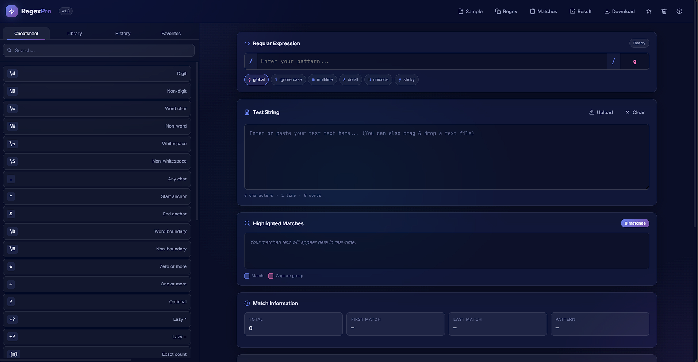

<div align="center">

# ⚡ Regex Pro

### A Modern, Powerful Regex Tester for Developers

Built with pure HTML, CSS & JavaScript — zero dependencies, zero backend, zero build step.

[**Live Demo**](#) · [**Report Bug**](../../issues) · [**Request Feature**](../../issues)


---



</div>

## ✨ Features

### 🎯 Core Engine
- ⚡ **Live matching** as you type — instant feedback, no submit button
- 🎨 **Highlighted matches** with distinct colors for capture groups (supports 6+ groups)
- 🏁 **Flag toggles** for `d`, `g`, `i`, `m`, `s`, `u`, `v`, `y` plus text input (where supported by the browser)
- 📊 **Detailed match info** — positions, lengths, captured & named groups
- ❌ **Friendly error messages** for invalid regex patterns
- 🛡️ **Worker-isolated execution** with a 2.5-second timeout and a manual Stop control
- 🧯 **Resource limits** for pattern length, text size, matches, split segments, and replacement output
- 🧩 **Correct capture offsets** and Unicode-safe zero-width match advancement
- 📱 **100% responsive** — works beautifully on mobile, tablet & desktop

### 🛠️ Developer Tools
- 🔍 **Replace tool** with `$1`, `$&`, `$$`, `` $` ``, `$'` support — preview, first, all, apply
- ✂️ **Split tool** with visual segment display
- 💡 **Regex Explainer** — converts any pattern to plain English
- 📚 **20+ ready-to-use patterns** — Email, IPv4, IPv6, UUID, URL, Credit Card & more
- 📖 **Searchable cheatsheet** with hover tooltips for every token

### 💾 Persistence
- 🕒 **History** — last 20 patterns auto-saved to `localStorage`
- ⭐ **Favorites** — star your best patterns for quick access
- 🧹 **Validated stored state** — malformed history and favorites are normalized before rendering
- 💿 **Auto-save** — your work persists across page reloads
- 📂 **Drag & drop** text files (up to 5MB) directly into the editor

### ⌨️ Productivity
- 🎹 **Keyboard shortcuts** for every major action
- ↔️ **Resizable sidebar** — drag to customize your workspace
- 📋 **Copy / Download** — JSON or TXT export of results
- 🎨 **Modern dark theme** — glassmorphism with smooth animations

---

## 🚀 Quick Start

**Use a local HTTP server.** Regex Pro evaluates patterns inside a Web Worker; opening `index.html` directly with `file://` can prevent the worker and shared core from loading.

```bash
# Clone the repository
git clone https://github.com/ItsWanheda/regex-pro.git
cd regex-pro

# Python 3 (built-in; no dependencies)
python -m http.server 8000
```
Then visit http://localhost:8000/src/

### Alternative static servers

```bash
# Node.js
npx serve .

# PHP
php -S localhost:8000
```

## 🎹 Keyboard Shortcuts

| Shortcut | Action |
|----------|--------|
| `Ctrl` + `Enter` | Force re-run matching |
| `Ctrl` + `K` | Focus regex input |
| `Ctrl` + `L` | Clear all fields |
| `Ctrl` + `D` | Save current regex to favorites |
| `Ctrl` + `Shift` + `C` | Copy regex |
| `Ctrl` + `Shift` + `R` | Apply replacement to text |
| `Esc` | Close modals / menus |
| `?` | Show shortcuts help |

---

## 🧩 Tech Stack


| Layer | Technology |
|-------|------------|
| Markup | Semantic HTML5 |
| Styling | Modern CSS3 (custom properties, backdrop-filter, grid, flexbox) |
| Behavior | Vanilla JavaScript (ES2020+, no frameworks) |
| Fonts | [Inter](https://fonts.google.com/specimen/Inter) + [JetBrains Mono](https://fonts.google.com/specimen/JetBrains+Mono) |

**Zero runtime dependencies**. The only external resource is Google Fonts, which is gracefully degradable — the app works fully offline if needed.

---

## 🎨 Design Highlights
* 🌑 **Dark glassmorphism** with multi-layered radial gradients
* 🎨 **Gradient accents** (indigo → purple → cyan)
* 💫 **Smooth animations** — fade, slide, shake, toast
* 📐 **Sticky sidebar** on desktop, collapsible on mobile
* ♿ **Accessible** — semantic HTML, ARIA labels, keyboard nav, reduced-motion support

---

## 🧪 Browser Support
| Browser | Version |
|---------|---------|
| Chrome / Edge | 90+ |
| Firefox | 88+ |
| Safari | 14+ |
| Mobile Safari | iOS 14+ |
| Chrome Android | 90+ |

> Uses the modern RegExp d flag for indices. Fallback gracefully omits nested group highlighting on older browsers.

---

## 🧪 Automated Tests

The project keeps zero runtime dependencies. With Node.js 18 or later installed, run:

```bash
npm test
```

The regression suite covers capture offsets, named and unmatched groups, zero-width and Unicode behavior, flag validation, partial-result warnings, worker timeout termination, HTML escaping, persistence recovery, replacement, and split behavior. GitHub Actions runs the suite on pushes and pull requests. See the [regression checklist](./docs/REGRESSION_CHECKLIST.md) for the full scenario list.

### Safety limits
- Pattern: 10,000 characters maximum
- Test text: 5,000,000 characters maximum
- Matches and split segments: 50,000 each
- Replacement input: 10,000 characters maximum
- Worker evaluation timeout: 2.5 seconds for UI operations

A timeout terminates the worker so pathological patterns cannot indefinitely block the page's main thread. These limits reduce resource-exhaustion risk but cannot guarantee every pattern will finish within the time budget.

---

## 🤝 Contributing
Contributions make the open source community an amazing place to learn, inspire, and create. Any contribution you make is **greatly appreciated**.

1. Fork the project
2. Create your feature branch (`git checkout -b feature/AmazingFeature`)
3. Commit your changes (`git commit -m 'Add some AmazingFeature'`)
4. Push to the branch (`git push origin feature/AmazingFeature`)
5. Open a Pull Request

Please read [Contributing.MD](./CONTRIBUTING.MD) for details on our code of conduct and the process for submitting pull requests.

---

📜 License

Distributed under the MIT License. See [LICENSE](./LICENSE) for the full text.
This means you can use, modify, distribute, and even sell projects based on this code — commercially or otherwise — as long as the copyright notice is preserved.

---

## 🙏 Acknowledgments
* Design inspiration from modern developer tools like [regex101](https://regex101.com/), [RegExr](https://regexr.com/), and [DevTools](https://developer.chrome.com/docs/devtools/)
* Icons hand-crafted as inline SVGs (no icon library bloat)

---

## ⭐ Show Your Support
If this project helped you or you found it interesting, please consider giving it a star ⭐ — it helps others discover it too!
<div align="center">
<sub>Made with ❤️ and vanilla JavaScript</sub>
</div>
